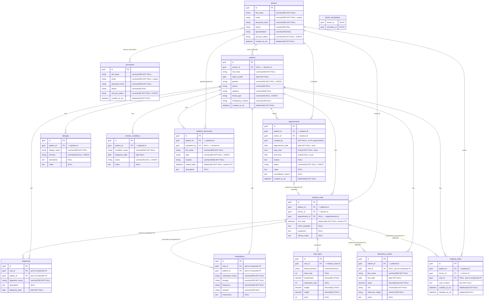

# Medilog — Entity Relationship Diagram (ERD)

> Status: **implemented** persistence foundation.
> Source of truth: the generated migration
> `src/Medilog.Infrastructure/Persistence/Migrations/20261109211333_InitialCreate.cs`
> and its generated SQL. The diagram below describes the model that EF Core
> actually produces, not an idealized design.

## 1. Scope

The database contains **13 domain tables** plus **one pure association table**:

| # | Domain class | Table |
|---|---|---|
| 1 | `Doctor` | `doctors` |
| 2 | `Patient` | `patients` |
| 3 | `MedicalVisit` | `medical_visits` |
| 4 | `Diagnosis` | `diagnoses` |
| 5 | `Medication` | `medications` |
| 6 | `Allergy` | `allergies` |
| 7 | `ChronicCondition` | `chronic_conditions` |
| 8 | `VitalSigns` | `vital_signs` |
| 9 | `LaboratoryResult` | `laboratory_results` |
| 10 | `MedicalNote` | `medical_notes` |
| 11 | `MedicalDocument` | `medical_documents` |
| 12 | `Secretary` | `secretaries` |
| 13 | `Appointment` | `appointments` |
| — | `Doctor` ↔ `Secretary` join | `doctor_secretaries` |

There are no extra domain entities. Medical-history tables are never
cascade-deleted. Only the pure association table cascades.

All application tables are created with `CHARACTER SET utf8mb4 COLLATE
utf8mb4_0900_ai_ci`.

## 2. Entity Relationship Diagram



## 3. Keys and constraints

### Primary keys

Every table has a single-column primary key on `id` (type `char(36)`), except
`doctor_secretaries`, whose primary key is the composite
`(doctor_id, secretary_id)`.

### Alternate (unique) keys

| Table | Alternate key | Purpose |
|---|---|---|
| `appointments` | `ak_appointments_id_patient_id_doctor_id (id, patient_id, doctor_id)` | Principal key for the composite FK from `medical_visits` (A-25 R3). |
| `medical_visits` | `ak_medical_visits_id_patient_id (id, patient_id)` | Principal key that lets child rows prove they belong to the same patient as their visit. |

### Unique indexes

| Table | Unique index | Purpose |
|---|---|---|
| `doctors` | `uq_doctors_email (email)` | One account per email. |
| `secretaries` | `uq_secretaries_email (email)` | One account per email. |
| `medical_visits` | `uq_medical_visits_appointment_id (appointment_id)` | At most one visit per appointment. Multiple `NULL`s are allowed by MySQL. |
| `medical_visits` | `IX_medical_visits_appointment_id_patient_id_doctor_id (appointment_id, patient_id, doctor_id)` | EF-generated unique index for the optional one-to-one composite FK. Also allows multiple `NULL`s. |

### Foreign keys and delete behavior

| FK constraint | Dependent → principal | Delete behavior |
|---|---|---|
| `fk_patients_doctor` | `patients.doctor_id` → `doctors.id` | `RESTRICT` |
| `fk_doctor_secretaries_doctor` | `doctor_secretaries.doctor_id` → `doctors.id` | `CASCADE` (association row only) |
| `fk_doctor_secretaries_secretary` | `doctor_secretaries.secretary_id` → `secretaries.id` | `CASCADE` (association row only) |
| `fk_appointments_patient` | `appointments.patient_id` → `patients.id` | `RESTRICT` |
| `fk_appointments_doctor` | `appointments.doctor_id` → `doctors.id` | `RESTRICT` |
| `fk_medical_visits_patient` | `medical_visits.patient_id` → `patients.id` | `RESTRICT` |
| `fk_medical_visits_doctor` | `medical_visits.doctor_id` → `doctors.id` | `RESTRICT` |
| `fk_medical_visits_appointment` | `medical_visits.(appointment_id, patient_id, doctor_id)` → `appointments.(id, patient_id, doctor_id)` | `RESTRICT` |
| `fk_diagnoses_patient` | `diagnoses.patient_id` → `patients.id` | `RESTRICT` |
| `fk_diagnoses_visit` | `diagnoses.(visit_id, patient_id)` → `medical_visits.(id, patient_id)` | `RESTRICT` |
| `fk_medications_patient` | `medications.patient_id` → `patients.id` | `RESTRICT` |
| `fk_medications_visit` | `medications.(visit_id, patient_id)` → `medical_visits.(id, patient_id)` | `RESTRICT` |
| `fk_allergies_patient` | `allergies.patient_id` → `patients.id` | `RESTRICT` |
| `fk_chronic_conditions_patient` | `chronic_conditions.patient_id` → `patients.id` | `RESTRICT` |
| `fk_vital_signs_visit` | `vital_signs.visit_id` → `medical_visits.id` | `RESTRICT` |
| `fk_laboratory_results_patient` | `laboratory_results.patient_id` → `patients.id` | `RESTRICT` |
| `fk_laboratory_results_visit` | `laboratory_results.(visit_id, patient_id)` → `medical_visits.(id, patient_id)` | `RESTRICT` |
| `fk_medical_notes_patient` | `medical_notes.patient_id` → `patients.id` | `RESTRICT` |
| `fk_medical_notes_doctor` | `medical_notes.doctor_id` → `doctors.id` | `RESTRICT` |
| `fk_medical_notes_visit` | `medical_notes.(visit_id, patient_id)` → `medical_visits.(id, patient_id)` | `RESTRICT` |
| `fk_medical_documents_patient` | `medical_documents.patient_id` → `patients.id` | `RESTRICT` |
| `fk_medical_documents_doctor` | `medical_documents.uploaded_by` → `doctors.id` | `RESTRICT` |

No foreign key uses `SET NULL`, and no medical relationship cascades. The only
cascades are on the `doctor_secretaries` association rows, where deleting a
doctor or secretary may remove their assignment rows without touching medical
records.

`appointments.created_by` deliberately has **no** foreign key because it is a
polymorphic reference to either a doctor or a secretary. Referential integrity
for this column must be enforced in the application flow.

### Check constraints

| Constraint | Rule |
|---|---|
| `ck_doctors_account_status` | `account_status IN ('Active','Inactive')` |
| `ck_secretaries_account_status` | `account_status IN ('Active','Inactive')` |
| `ck_patients_gender` | `gender IN ('Male','Female')` |
| `ck_patients_blood_type` | `blood_type IS NULL OR blood_type IN ('A+','A-','B+','B-','AB+','AB-','O+','O-')` |
| `ck_allergies_severity` | `severity IS NULL OR severity IN ('Mild','Moderate','Severe')` |
| `ck_chronic_conditions_status` | `status IS NULL OR status IN ('Active','Controlled','Resolved')` |
| `ck_medical_documents_type` | `type IN ('PDF','JPG','JPEG','PNG')` |
| `ck_appointments_status` | `status IN ('Scheduled','Confirmed','Completed','Cancelled','No-Show')` |
| `ck_appointments_end_time_after_start_time` | `end_time IS NULL OR end_time > start_time` |

## 4. Relationship notes

### Doctor → Patient (optional one-to-many)

The Class Specification table for `Patient` does not mark `doctorId` as
required, while BRULE-03 describes a patient as belonging to the creating
doctor's workspace. The persistence layer follows the table literally:
`patients.doctor_id` is nullable and the relationship is optional. Ownership
must still be enforced by the application when a patient is created.

### Doctor / Secretary (many-to-many)

Mapped through the pure association table `doctor_secretaries`, with composite
primary key `(doctor_id, secretary_id)`. Deleting a doctor or a secretary
cascades only to the assignment rows.

### Appointment → MedicalVisit (optional one-to-one, composite)

An appointment may produce at most one visit, and a visit may reference at most
one appointment. The relationship is implemented as:

- Principal alternate key: `appointments (id, patient_id, doctor_id)`.
- Dependent foreign key: `medical_visits (appointment_id, patient_id, doctor_id)`.
- `medical_visits.appointment_id` is nullable.
- `medical_visits.appointment_id` has a unique index.

This preserves patient and doctor consistency: a visit cannot point at an
appointment for a different patient or doctor. Because `appointment_id` is
`NULL`-able, MySQL allows any number of visits with no appointment while still
enforcing uniqueness for non-null values.

### Visit children (diagnoses, medications, notes, lab results)

These rows carry `patient_id`, which is shared by two relationships:

- A direct `patient_id → patients.id` foreign key.
- A composite `(visit_id, patient_id) → medical_visits (id, patient_id)` foreign key.

The composite key is what prevents a diagnosis, medication, note, or lab result
from being attached to a visit that belongs to a different patient. The direct
patient FK is retained as well, so patient-only queries and restrictions do not
need to join through the visit.

`medical_visits` has the supporting alternate key `(id, patient_id)` so those
composite foreign keys have a valid principal key.

## 5. Enum storage

Enums are stored as their specification labels in `varchar(20)` columns, not as
integers, and each relevant column has a `CHECK` constraint:

| Enum | Stored labels |
|---|---|
| `AccountStatus` | `Active`, `Inactive` |
| `Gender` | `Male`, `Female` |
| `BloodType` | `A+`, `A-`, `B+`, `B-`, `AB+`, `AB-`, `O+`, `O-` |
| `AllergySeverity` | `Mild`, `Moderate`, `Severe` |
| `ChronicConditionStatus` | `Active`, `Controlled`, `Resolved` |
| `MedicalDocumentType` | `PDF`, `JPG`, `JPEG`, `PNG` |
| `AppointmentStatus` | `Scheduled`, `Confirmed`, `Completed`, `Cancelled`, `No-Show` |

## 6. Time representation

| Column | CLR type | SQL type | Meaning |
|---|---|---|---|
| `medical_visits.visit_date` | `DateTimeOffset` | `datetime(6)` | UTC instant; normalized before writing, read back with offset `+00:00`. |
| `medical_documents.upload_date` | `DateTimeOffset` | `datetime(6)` | UTC instant, set by the upload flow. |
| `*.created_at_utc` | `DateTimeOffset` | `datetime(6)` | UTC audit instant. |
| `medical_notes.updated_at_utc` | `DateTimeOffset?` | `datetime(6)` | UTC audit instant. |
| `appointments.appointment_date` | `DateOnly` | `date` | Clinic-local wall-clock date. |
| `appointments.start_time` | `TimeOnly` | `time(0)` | Clinic-local wall-clock time. |
| `appointments.end_time` | `TimeOnly?` | `time(0)` | Clinic-local wall-clock time. |

The clinic timezone is **not** stored in the database in this scope. Converting
an appointment's local date/time to a UTC instant requires an application-level
clinic timezone setting. See `PERSISTENCE_FOUNDATION.md` for daylight-saving
constraints.

## 7. How this ERD was verified

The model and SQL were produced from the real EF Core model, not drawn by hand:

```bash
cd backend
dotnet ef migrations script 0 InitialCreate \
  --project src/Medilog.Infrastructure \
  --startup-project src/Medilog.Infrastructure
```

The generated script contains 14 application tables, 22 explicit foreign keys,
14 `CHARACTER SET utf8mb4` clauses, 14 `COLLATE utf8mb4_0900_ai_ci` clauses, no
`MATCH` token, and `ON DELETE RESTRICT` on every medical relationship. The
local MySQL round-trip was **not** executed because no MySQL server, Docker, or
WSL distribution is available in the build environment.
